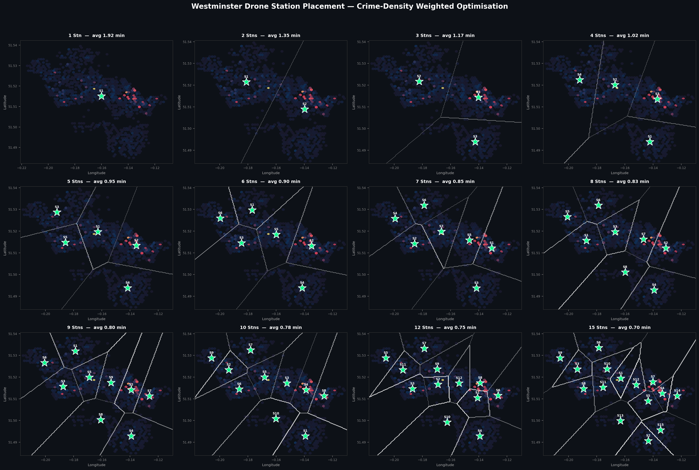
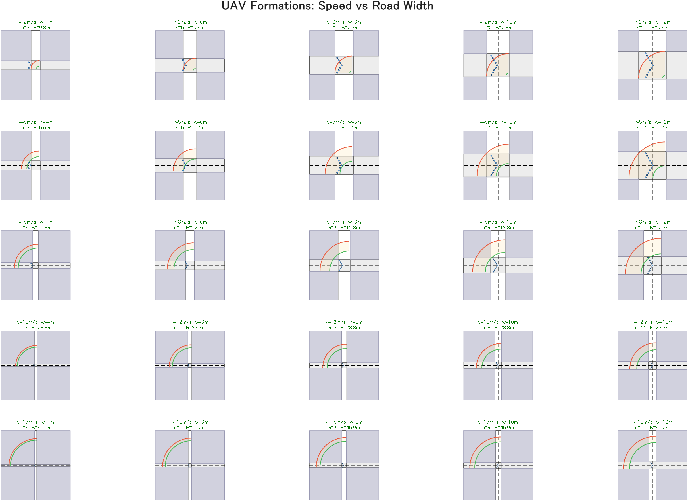
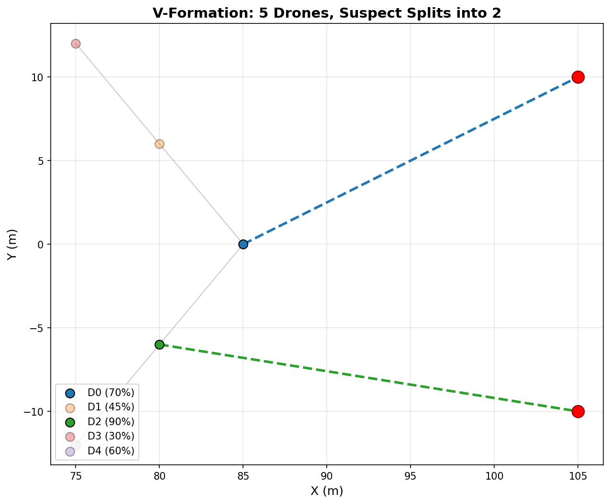

# PADS — Police Drone Array System

PADS is a simulation framework for a network of autonomous police drones that respond to
burglary call-outs in Westminster, London. When an alarm is raised, a drone launches from
the nearest station, flies to the scene, and tracks a fleeing suspect through city
streets, keeping line of sight and avoiding buildings, while the officers on the ground
catch up.

The repository covers the full pipeline:

1. **Where to put the drones.** Choose drone station locations from real crime data so
   that a drone can reach any incident within about 1.5 minutes.
2. **How one drone chases a suspect.** Model Predictive Control (MPC) pursuit with
   roll/pitch dynamics, tilt limits, building collision avoidance and line-of-sight
   occlusion, on synthetic and real (OpenStreetMap) street maps.
3. **How robust and well tuned it is.** Kalman-filter state estimation under sensor
   noise, and Bayesian optimisation of the MPC weights.
4. **How several drones work together.** Formation control (Virtual Structure,
   Leader–Follower, Consensus + APF, Hybrid) and target re-assignment when a group of
   suspects splits up.

> This was built as a third-year engineering group project (3YP). It is research and
> simulation code, not flight software.

<p align="center">
  
  
</p>

---

## Repository layout

| Folder | Language | What it does |
|---|---|---|
| [`station_location/`](station_location) | Python | Merges monthly police.uk street-crime CSVs and keeps only burglaries. |
| [`files/`](files) | Python | **Station placement optimiser.** Weighted K-Means over burglary locations, with a response-time model and a sweep over 1–15 stations. |
| [`quad_sim/`](quad_sim) | MATLAB | First prototype: a 2D quadcopter tracking a walking target through a T-shaped corridor using MPC and a min-jerk planner. |
| [`simulator_main/files/`](simulator_main/files) | MATLAB | 2D MPC chase at a synthetic road intersection: roll/pitch dynamics, hard building constraints, LoS dropouts and a video of the MPC prediction. Also renders a synthetic front-camera view. |
| [`simulator_obstacle/`](simulator_obstacle) | MATLAB | The same chase with a road obstacle, detected within 5 m and avoided reactively (repulsive potential plus safety filter). |
| [`mpc_chase/`](mpc_chase) | MATLAB + Python | **Real-map chase** on Westminster building footprints and roads, plus the noise/Kalman-filter sweep, MPC weight optimisation and formation-geometry analysis. |
| [`mpc_chase/map_extract/`](mpc_chase/map_extract) | Python + MATLAB | Converts OpenStreetMap GeoJSON exports into the `westminster_map.mat` file used by the real-map simulations. |
| [`multi_drone/`](multi_drone) | Python | **Multi-drone experiments.** Five formation controllers compared across four scenarios, plus Hungarian-algorithm target assignment when suspects split up. |

---

## Requirements

**MATLAB** (R2021a or later recommended) with the **Optimization Toolbox**. Every MPC
solve uses `quadprog`.

**Python 3.10+**. Install the packages for the parts you want to run:

```bash
# Multi-drone experiments
pip install -r multi_drone/requirements.txt        # numpy, scipy, matplotlib, osqp

# Station optimiser, map extraction and weight optimisation
pip install pandas openpyxl scikit-learn networkx scikit-optimize

# Optional: faster MP4 writing from Python
pip install "imageio[ffmpeg]"
```

### Data files are not in the repo

Raw data and generated outputs (`*.csv`, `*.json`, `*.xlsx`, `*.mat`, `*.geojson`, videos)
are excluded by [`.gitignore`](.gitignore). To run the parts that need them, rebuild them
first as described in each section below:

| File | Needed by | How to get it |
|---|---|---|
| `westminster_burglaries_filtered.xlsx` (repo root) | Station optimiser | Download street-crime data from [data.police.uk](https://data.police.uk/data/), run `station_location/extract.py`, then save the result as an `.xlsx` with longitude in column E and latitude in column F. |
| `mpc_chase/map_extract/buildings.geojson`, `roads.geojson` | Map extraction | Export from [overpass-turbo.eu](https://overpass-turbo.eu). The exact queries are in the docstring of `extract_westminster_map.py`. |
| `mpc_chase/westminster_map.mat` | All real-map MATLAB simulations | Generated by `extract_westminster_map.py`. |

---

## How to use

### 1. Choose drone station locations

```bash
# (a) Build the burglary dataset from police.uk CSVs.
#     First edit base_dir at the top of extract.py to point at your downloaded folder.
python station_location/extract.py

# (b) Run the optimiser (reads westminster_burglaries_filtered.xlsx from the repo root)
python files/drone_station_optimizer.py
```

The optimiser gives each incident a false-alarm probability, clusters incidents with
weighted K-Means for k = 1–15 stations, and estimates the response time for each
incident. The response-time model includes a 20 s climb and a 20 s descent, a 15 m/s
cruise speed and a 5.6 m/s² acceleration limit. It writes the following to `output/`:

- `station_maps_grid.png`: station layouts drawn over a map of Westminster crime density
- `response_time_table_chart.png` and `response_time_table.csv`: average response time against number of stations
- `optimal_1_5min_stations.png`: the configuration closest to a 1.5-minute average response

Drone parameters (`V_MAX`, `A_MAX`, `T_UP`, `T_DOWN`) and the target time
(`TARGET_TIME`) are constants at the top of the script.

### 2. Single-drone chase in a corridor (prototype)

```matlab
cd quad_sim
main_sim
```

Edit `setup_params.m` to change the MPC horizon and weights, the drone limits or the
simulation length.

### 3. Single-drone chase at an intersection

```matlab
cd simulator_main/files
simulate_mpc_chase_2D_rollpitch_video_V2     % chase + MP4 with the MPC prediction overlaid
front_camera_view                            % synthetic forward-camera video of the same chase

cd ../../simulator_obstacle
simulate_mpc_chase_2D_rollpitch_video        % adds a road obstacle and reactive avoidance
```

Each script prints energy-use and oscillation metrics and writes an MP4. All parameters
are set in the `P.` struct at the top of each file.

### 4. Chase on the real Westminster map

```bash
# Build the map once
cd mpc_chase/map_extract
#   put buildings.geojson and roads.geojson here (see the docstring for the Overpass queries)
python extract_westminster_map.py
cp westminster_map.mat ..        # the simulations look for it in mpc_chase/
```

```matlab
cd mpc_chase
simulate_westminster_chase       % MPC chase along a real route, with building LoS + collision avoidance
simulate_noise_kf_sweep          % sweep GPS/tracker noise and KF process noise, plot heatmaps
uav_formation_analysis           % formation shapes vs road width and speed, plus a turn animation
```

`preview_westminster_map` (in `map_extract/`) plots the loaded map, so you can check it
before running a simulation.

### 5. Tune the MPC weights with Bayesian optimisation

```bash
cd mpc_chase
python optimize_mpc_weights.py
```

This calls MATLAB headlessly, once per evaluation, through `run_mpc_weights_trial.m`. It
searches over `w_pos`, `w_vel`, `w_u` and `w_du` using Gaussian-process Bayesian
optimisation, then writes `weight_optimization_convergence.png` and
`weight_optimization_results.png`. `matlab` must be on your `PATH`; otherwise set
`MATLAB_CMD` at the top of the script. You can change the number of evaluations with
`N_CALLS`.

### 6. Multi-drone formations and target assignment

```bash
cd multi_drone
python smoke_test.py                                    # quick check that everything runs
python experiment_runner.py --method VS --experiment nominal --seed 1 --duration 20 --no-video
python experiment_runner.py                             # full batch: 5 methods x 4 experiments x 5 seeds
python plotting.py                                      # comparison plots in results/plots/
python report.py                                        # results/report.md

# Re-assign drones when the suspects split up (Hungarian algorithm, cost = ETA + battery)
python split_scenario.py           # 3 drones, 1 suspect splits into 3
python complex_split_scenario.py   # 6 drones, a group splits into 6
python v_formation_split2.py       # 5 drones in a V, suspect splits into 2 (best 2 of 5 chosen)
```

See [`multi_drone/README.md`](multi_drone/README.md) for the controllers, scenarios and
CLI options, and [`multi_drone/results/report.md`](multi_drone/results/report.md) for the
comparison results.

<p align="center">
  
</p>

---

## Shared MPC formulation

All of the chase simulators use the same QP-based MPC (`solveMPC_QP.m`, ported to Python
as `multi_drone/mpc_solver.py`):

- **Model:** a 2D double integrator, with first-order roll/pitch response mapping
  commanded acceleration to tilt
- **Cost:** position and velocity tracking error, control effort, and control smoothness
  (Δu)
- **Constraints:** per-axis acceleration bounds, derived from the tilt limit
- **Safety:** a post-MPC safety filter (`safetyFilterAccel.m`) that keeps the drone
  outside inflated building polygons
- **Sensing:** the target is visible only while there is line of sight
  (`hasLineOfSight.m`). When the line is blocked, the drone tracks the last estimate.
