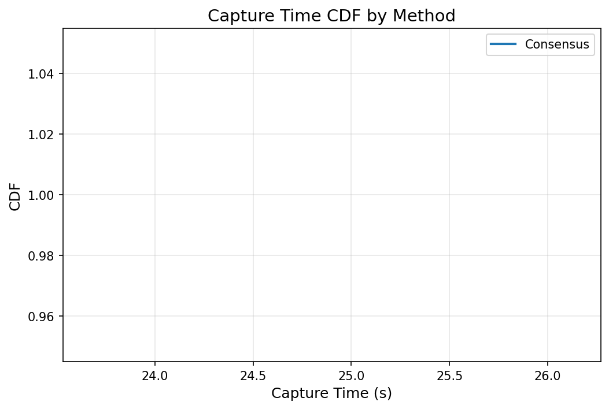
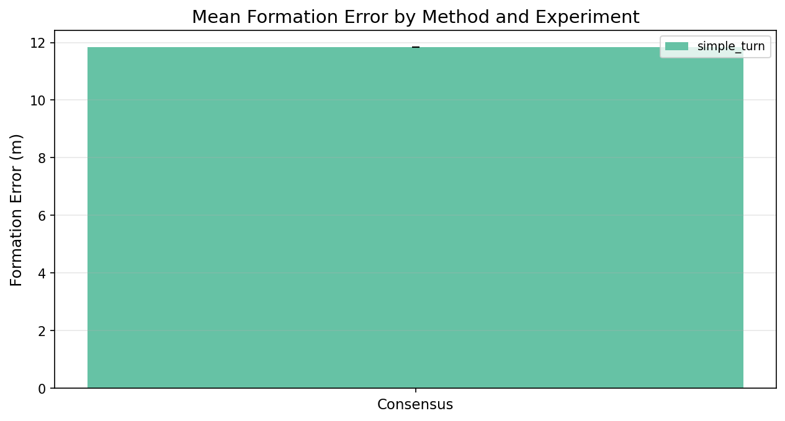
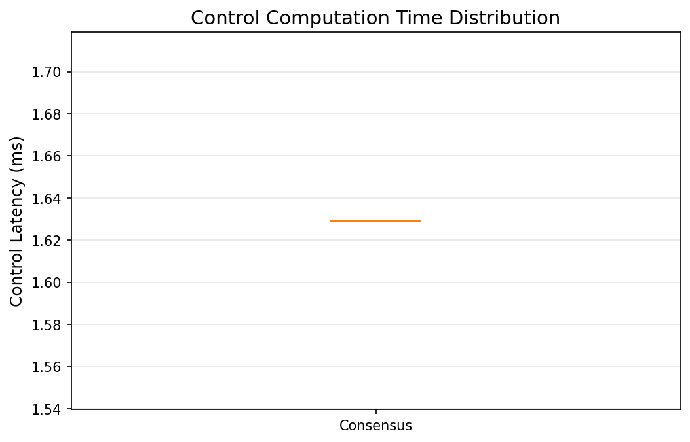
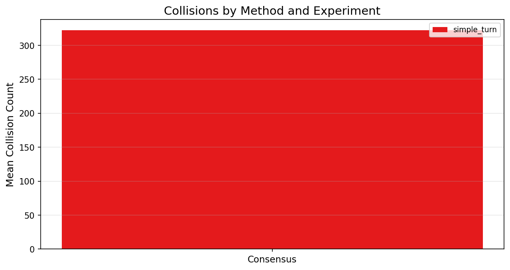
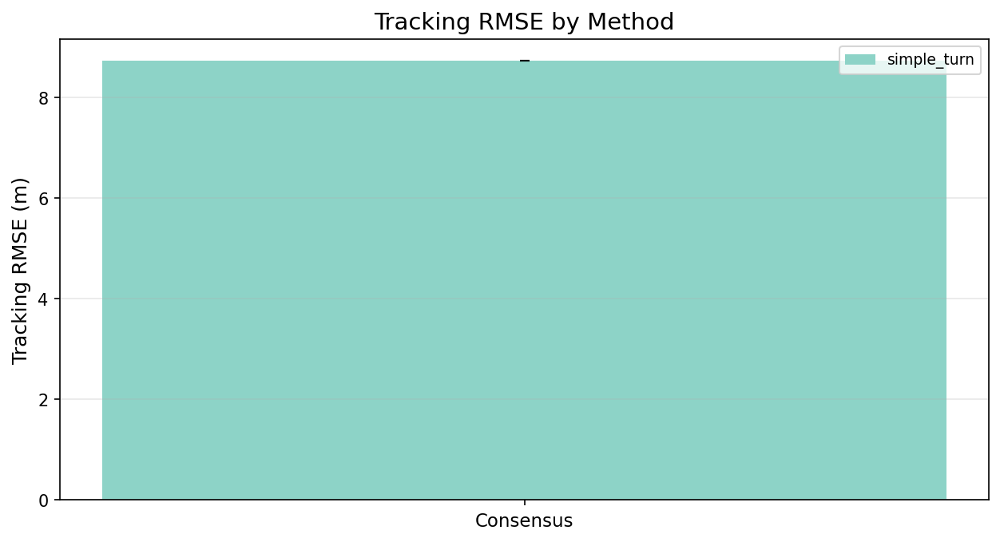

# Multi-Drone Formation Chase: Comparative Results

## Overview

This report compares 5 formation control methods for 3 quadcopters pursuing a single target through a synthetic urban corridor with a 90° turn.

**Methods**: Virtual Structure (VS), Leader-Follower (LF), Consensus+APF, Hybrid (VS+Heuristic Reactive), Baseline (independent MPC)

**Experiments**: Nominal, Comms Degraded (30% drop, 100ms latency), High Noise (σ_pos=0.5m), Narrow Turn (8m width)

Each experiment was run with 5 random seeds.

## Comparison Table

| Method | Experiment | Capture Time (s) | Formation Error (m) | Tracking RMSE (m) | Collisions | Latency (ms) | Energy |
|--------|-----------|----------------:|-------------------:|-----------------:|-----------:|-------------:|-------:|
| Baseline | comms_degraded | 3.2 ± 0.0 | N/A | 12.48 ± 0.01 | 5 | 0.4 | 206 |
| Baseline | high_noise | 3.3 ± 0.0 | N/A | 12.44 ± 0.02 | 3 | 0.5 | 207 |
| Baseline | narrow_turn | 3.2 ± 0.0 | N/A | 12.48 ± 0.01 | 5 | 0.5 | 206 |
| Baseline | nominal | 3.2 ± 0.0 | N/A | 12.48 ± 0.01 | 5 | 0.4 | 206 |
| Consensus | comms_degraded | 3.6 ± 0.0 | 10.57 ± 0.02 | 12.28 ± 0.01 | 0 | 1.6 | 109 |
| Consensus | high_noise | 3.6 ± 0.0 | 10.66 ± 0.02 | 12.28 ± 0.02 | 0 | 2.1 | 108 |
| Consensus | narrow_turn | 3.6 ± 0.0 | 10.65 ± 0.02 | 12.28 ± 0.01 | 0 | 2.4 | 109 |
| Consensus | nominal | 3.6 ± 0.0 | 10.65 ± 0.02 | 12.28 ± 0.01 | 0 | 1.7 | 109 |
| Hybrid | comms_degraded | 3.2 ± 0.0 | 14.44 ± 0.02 | 12.48 ± 0.01 | 0 | 1.2 | 136 |
| Hybrid | high_noise | 3.3 ± 0.0 | 14.40 ± 0.05 | 12.44 ± 0.02 | 0 | 1.1 | 137 |
| Hybrid | narrow_turn | 3.2 ± 0.0 | 14.44 ± 0.02 | 12.48 ± 0.01 | 0 | 1.2 | 136 |
| Hybrid | nominal | 3.2 ± 0.0 | 14.44 ± 0.02 | 12.48 ± 0.01 | 0 | 1.1 | 136 |
| LF | comms_degraded | 3.2 ± 0.0 | 5.70 ± 0.04 | 12.48 ± 0.01 | 0 | 2.0 | 178 |
| LF | high_noise | 3.3 ± 0.0 | 5.76 ± 0.09 | 12.44 ± 0.02 | 0 | 2.0 | 180 |
| LF | narrow_turn | 3.2 ± 0.0 | 5.70 ± 0.04 | 12.48 ± 0.01 | 0 | 2.3 | 178 |
| LF | nominal | 3.2 ± 0.0 | 5.70 ± 0.04 | 12.48 ± 0.01 | 0 | 1.9 | 178 |
| VS | comms_degraded | 3.2 ± 0.0 | 11.73 ± 0.01 | 12.48 ± 0.01 | 0 | 2.1 | 187 |
| VS | high_noise | 3.3 ± 0.0 | 11.67 ± 0.08 | 12.44 ± 0.02 | 0 | 2.0 | 190 |
| VS | narrow_turn | 3.2 ± 0.0 | 11.73 ± 0.01 | 12.48 ± 0.01 | 0 | 2.1 | 187 |
| VS | nominal | 3.2 ± 0.0 | 11.73 ± 0.01 | 12.48 ± 0.01 | 0 | 2.0 | 187 |

## Strengths and Weaknesses

### VS
**Strengths**: Rigid formation shape maintained well; predictable behaviour; all drones use MPC for smooth trajectories.

**Weaknesses**: Formation may collide with obstacles in tight turns since nodes don't adapt to geometry; higher computational cost (3× MPC).

### LF
**Strengths**: Simple offset tracking is easy to implement and tune; leader's MPC path is directly reused from single-drone case.

**Weaknesses**: Followers lag behind leader in turns; offset tracking breaks when leader manoeuvres sharply; single point of failure at leader.

### Consensus
**Strengths**: No single point of failure; distributed and resilient to individual drone failures; works under degraded comms.

**Weaknesses**: Slower convergence; formation shape is approximate; APF can cause oscillations near obstacles; higher comm overhead.

### Hybrid
**Strengths**: Best of VS (global shape) + reactive local obstacle negotiation; smooth blending avoids APF oscillations.

**Weaknesses**: Heuristic reactive policy is hand-tuned (no RL); still has 3× MPC computational cost.

### Baseline
**Strengths**: Simplest implementation; each drone independently optimal for target capture.

**Weaknesses**: No formation maintenance at all; drones may collide with each other; no coordination; worst-case for multi-drone safety.

## Recommendation for Real Deployment

For real-world deployment in urban environments:

1. **Hybrid (VS+Reactive)** is recommended for narrow/complex environments. It maintains formation shape while adapting to local obstacles, reducing collision risk.

2. **Leader-Follower** is recommended for wider corridors with reliable comms. It is simpler to implement and debug, and the leader's MPC provides a proven baseline.

3. **Consensus+APF** is recommended when communication reliability is uncertain, as it degrades gracefully under packet drops.

4. **Virtual Structure** provides the tightest formation but requires obstacle-aware node placement (future work).

5. **Baseline** should be avoided — it provides no formation guarantees and creates inter-drone collision risk.

## Plots

## Notes

- The Hybrid method uses a hand-tuned heuristic reactive policy rather than a learned RL policy. Full PPO training was not feasible within the session.
- Simulation is 2D planar with fixed altitude (20m). Z-dynamics are not modelled.
- Communication model assumes broadcast; no routing or multi-hop.
- Energy estimate is a proxy (integral of squared control magnitude), not a calibrated battery model.
